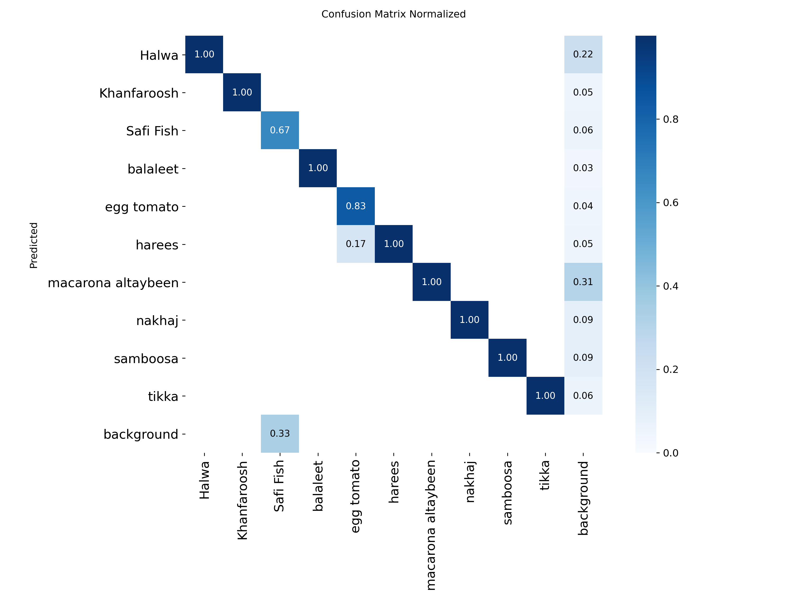
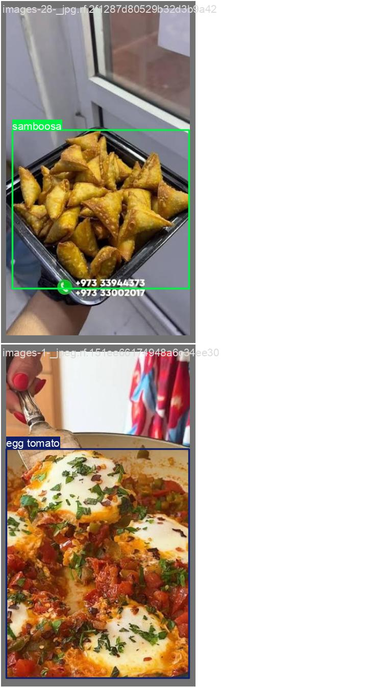

# 🍗 Bahraini Food Detector 🍳

**Live demo:** ([Bahraini Food Detector App](https://bahrainifoodobjectdetector.streamlit.app/))

An object detection model that recognizes Bahraini dishes in photos and live camera video. It is a YOLO model fine-tuned on a custom Roboflow dataset, with a Streamlit web app for trying it out.

## Features

- Detects Bahraini food items (e.g. Balaleet, Nakhaj, Tikka) with bounding boxes and confidence scores
- Two input modes in the app: **live camera** and **photo upload**
- Training and evaluation notebook with precision, recall, and a confusion matrix
- Error analysis: shows only the test images the model gets wrong

## Project Structure

```
.
├── app/
│   ├── Food_clf_detector.py              # Streamlit app (live camera + photo upload)
│   ├── best.pt                           # Trained model weights
│   └── requirements.txt                  # App dependencies
├── Code/                                 # Model training, evaluation, and error analysis
│   └── bahraini_food.py
├── images/                               # Images used in the project and README
│   ├── confusion_matrix_normalized.png
│   ├── val_batch2_labels.jpg
│   ├── val_batch2_pred.jpg
│   └── wrong_predictions.png
├── packages.txt                          # System libraries for Streamlit Cloud (libgl1, libglib2.0-0)
└── README.md
```

### Folder Notes

- **`app/`**: Everything needed to run the Streamlit app. `best.pt` must stay in the same folder as `app.py`.
- **`Code/`**: Scripts for training the model, evaluating it, and analyzing errors. Not needed to run the app.
- **`images/`**: Images used in the project and README.
- **`packages.txt`**: System packages installed by Streamlit Community Cloud. Must be in the repo root.

## Dataset

- **Source:** Roboflow, workspace `sara-dhaif`, project `bahrain_foods-dyyn5`, version 2
- **Format:** YOLO (`yolo26` export)
- **Splits:** train / valid / test

| Split | Images |
|-------|--------|
| Train | 70% |
| Valid | 20% |
| Test  | 10% |

**Classes:**     
           Halwa          
           Khanfaroosh        
             Safi Fish          
              balaleet       
            egg tomato      
                harees       
    macarona altaybeen         
                nakhaj         
              samboosa    
                 tikka

Class balance and annotation quality notes: 

| Class | Number of Objects |
|---|---:|
| Halwa | 184 |
| nakhaj | 137 |
| samboosa | 86 |
| Khanfaroosh | 73 |
| tikka | 50 |
| egg tomato | 46 |
| harees | 46 |
| macarona altaybeen | 40 |
| Safi Fish | 40 |
| balaleet | 40 |
| **Total** | **742** |

## Model and Training

- **Base model:** `yolo26s.pt` (Ultralytics)
- **Training:** fine-tuned on the dataset above, then continued for additional epochs

| Run | Epochs |
|-----|--------|
| Initial fine-tune | 10 |
| Continued (model 1) | 10 + 10 |
| Continued (model 2) | 20 + 30 |

```python
from ultralytics import YOLO

model = YOLO("yolo26s.pt")
model.train(data="Bahrain_Foods-2/data.yaml", epochs=10)
```

## Results

Evaluated on the held-out test split.

| Model | Precision | Recall | mAP50 | mAP50-95 |
|-------|-----------|--------|-------|----------|
| Fine-tuned (10 epochs) |0.79 | 0.90 | 0.882 | 0.725 |
| Continued (10 + 10) | 0.88 | 0.89 | 0.872 | 0.718 |
| Continued (10 + 30) | 0.92 | 0.92 | 0.894 | 0.763 |

Metrics come from:

```python
metrics = model.val(data="Bahrain_Foods-2/data.yaml", split="test")
print(metrics.box.mp, metrics.box.mr)
```



## Getting Started

### 1. Train in Google Colab

1. Open `bahraini_food.py` in Colab.
2. Add your Roboflow API key as a Colab secret named `ROBOFLOW_KEY`.
3. Run the cells in order. Weights are saved under `runs/detect/<run>/weights/` (`best.pt`, `last.pt`).


## Using the App

- **Live camera:** click *Start*, allow camera access, and detections are drawn on the video stream.
- **Upload photo:** upload a JPG or PNG and the annotated result is shown.



## Error Analysis

The notebook includes a short snippet that runs the model over the test images and displays only those where the predicted classes differ from the ground truth. Use it to spot missed items, extra detections, and commonly confused dishes.

## Limitations

- The dataset is small and limited to the dishes it was labeled with. Unseen dishes will be forced into the nearest known class.
- Performance may drop with unusual lighting, angles, or heavily mixed plates.
- Evaluation is on a single test split, so treat the numbers as an estimate.

## Tech Stack

Python, Ultralytics YOLO, Roboflow, Streamlit, streamlit-webrtc, OpenCV / PIL, Matplotlib

## Acknowledgments

Dataset annotated and hosted on Roboflow. Model built with Ultralytics YOLO.
